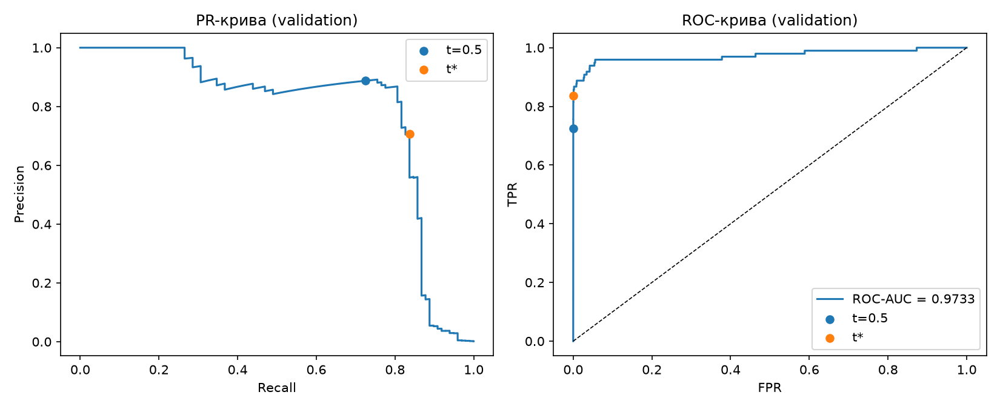

# ЛР2. Поріг рішення під асиметричну ціну помилок

Набір даних: [Credit Card Fraud Detection (Kaggle)](https://www.kaggle.com/datasets/mlg-ulb/creditcardfraud), файл `creditcard.csv` (284 807 транзакцій, 492 шахрайські).

## Запуск

Python 3.12, залежності зафіксовано в `pyproject.toml` / `uv.lock`.

```bash

cd 2
uv run python lab2_starter.py --data creditcard.csv --out results
uv run python analyze.py --saved results
uv run python check_search.py
```

`analyze.py` спочатку запускає перевірки A/B/C і не переходить до test, якщо вони не пройдені.

## Структура

| Файл | Призначення |
|---|---|
| `lab2_starter.py` | поділ даних, навчання моделі, збереження ваг і прогнозів |
| `thresholds.py` | TP/FP/FN/TN, вартість C, швидкий пошук порога (сортування + кумулятивні суми), повільний перебір для перевірки |
| `check_search.py` | перевірка пошуку на наборах A, B, C |
| `analyze.py` | криві, таблиця кандидатів, вибір t\*, оцінка test, розбір помилок |
| `results/` | `model.pt`, `predictions.npz`, `preprocessing.npz`, `run.json`, `split_summary.csv`, `validation_candidates.csv`, `validation_summary.csv`, `validation_curves.png`, `threshold.json`, `test_results.json`, `test_rules_reference.csv`, `test_error_examples.csv` |

## 1. Дані та навчання

Ознаки: `V1`-`V28` і `Amount` (29 ознак). `Class` і `Time` у модель не подаються; сире `Amount` зберігається окремо для аналізу помилок.

Поділ 60/20/20 стратифікований за `Class`: спочатку `train_test_split(idx, test_size=0.4, stratify=y, random_state=0)`, потім відкладені індекси діляться навпіл (`test_size=0.5`, стратифікація за відповідними мітками, `random_state=0`): перша частина - validation, друга - test. Початковий порядок рядків CSV зберігається в `*_row_ids`. Класи не балансуються.

| Вибірка | Об'єктів | Шахрайств | Частка шахрайств |
|---|---:|---:|---:|
| train | 170 884 | 295 | 0,1726 % |
| validation | 56 961 | 98 | 0,1720 % |
| test | 56 962 | 99 | 0,1738 % |

Стандартизація (`StandardScaler`) навчається лише на train, ті самі середні та масштаби застосовуються до validation і test. Статистики не можна рахувати на всьому наборі, бо тоді в параметри перетворення потрапляє інформація про validation і test (витік даних): оцінки на цих вибірках стають оптимістичними, а test перестає бути чесною імітацією нових даних.

Модель: `Linear(29,32) -> ReLU -> Linear(32,1)`, `BCEWithLogitsLoss` без зважування класів, Adam з lr = 1e-3, 12 епох, батч 1024, CPU, float32, `torch.manual_seed(0)`, перемішування через `np.random.default_rng(0)`. Використано ваги після 12-ї епохи (BCE на train: 0,3653 після 1-ї епохи, 0,003383 після 12-ї). Оцінки: $s_i = \sigma(z_i)$, де $z_i$ - вихідний логіт.

## 2. Вибір порога на validation

Правило: прогноз «шахрайство», якщо $s_i \ge t$. Підрахунки TP, FP, FN, TN реалізовано самостійно (`thresholds.confusion`). Вартість:

$$C(t) = 10\cdot FN(t) + FP(t)$$

$$\text{precision} = \frac{TP}{TP+FP},\qquad \text{recall} = \frac{TP}{TP+FN}$$

`Amount` у вартість не входить.



ROC-AUC на validation = **0,9733**. Крива ROC майже одразу піднімається до TPR ≈ 0,96, проте висока ROC-AUC не гарантує ні малої вартості, ні високої precision. Клас шахрайства дуже рідкісний (≈ 0,17 %), тому знаменник FPR - це ≈ 56 863 легітимні транзакції: навіть 34 хибні тривоги дають FPR ≈ 0,0006, що на ROC-кривій майже непомітно, а precision при цьому лише ≈ 0,71. Крім того, ROC-AUC усереднює якість ранжування за всіма порогами, а вартість залежить від одного конкретного порога і від співвідношення цін 10:1.

### Алгоритм пошуку порога

Кандидати: усі унікальні оцінки validation та $+\infty$ (всі негативні). Найменша оцінка відповідає «всі позитивні».

1. Оцінки сортуються за спаданням (`O(n log n)`).
2. Кумулятивні суми міток `cumsum(y)` і `cumsum(1-y)` дають TP і FP для кожної позиції.
3. Береться **остання** позиція кожної групи рівних оцінок, тому всі рівні оцінки отримують однаковий прогноз (а не розділяються за порядком у масиві).
4. $FN = P - TP$, $TN = N - FP$, де $P$, $N$ - кількість позитивних і негативних міток; рядок $+\infty$ додається окремо: TP = FP = 0.
5. Вибирається мінімум C; якщо мінімум досягається на кількох порогах, береться **найбільший** з них ($+\infty$ вважається найбільшим).

Повна таблиця кандидатів (55 945 рядків): `results/validation_candidates.csv`.

### Підсумок на validation

Зафіксований поріг: **t\* = 0,031194** (`results/threshold.json`).

| Правило на validation | Поріг | TP | FP | FN | TN | C |
|---|---:|---:|---:|---:|---:|---:|
| Стандартний поріг | 0,5 | 71 | 9 | 27 | 56 854 | 279 |
| Мінімум вартості | 0,031194 | 82 | 34 | 16 | 56 829 | **194** |
| Усі негативні | +∞ | 0 | 0 | 98 | 56 863 | 980 |

На validation при t\* precision = 82/116 ≈ 0,707, recall = 82/98 ≈ 0,837 (при t = 0,5: precision ≈ 0,888, recall ≈ 0,724). Обидві точки позначено на кривих.

## 3. Перевірка пошуку порога

Для кожного набору список кандидатів побудовано двома незалежними способами: швидким (кумулятивні суми) і прямим перебором, де для кожного кандидата правило $s_i \ge t$ застосовується до всіх прикладів. Повільний перебір не використовує результатів швидкого. Усі лічильники та вартості збіглися точно, обраний поріг однаковий.

**Набір A** (`s = [0,9; 0,7; 0,7; 0,4; 0,2; 0,1]`, `y = [0; 1; 0; 1; 0; 0]`)

| Поріг | TP | FP | FN | TN | C |
|---:|---:|---:|---:|---:|---:|
| +∞ | 0 | 0 | 2 | 4 | 20 |
| 0,9 | 0 | 1 | 2 | 3 | 21 |
| 0,7 | 1 | 2 | 1 | 2 | 12 |
| 0,4 | 2 | 2 | 0 | 2 | 2 |
| 0,2 | 2 | 3 | 0 | 1 | 3 |
| 0,1 | 2 | 4 | 0 | 0 | 4 |

Обраний t\* = **0,4**, C = 2. Набір перевіряє рівні оцінки: дві оцінки 0,7 мають мітки 1 і 0, їх не можна розділити порогом, тому при t = 0,7 обидві стають позитивними (TP = 1, FP = 2), і є лише один рядок для цього порога.

**Набір B** (`s = [0,9; 0,6; 0,3]`, `y = [0; 0; 0]`)

| Поріг | TP | FP | FN | TN | C |
|---:|---:|---:|---:|---:|---:|
| +∞ | 0 | 0 | 0 | 3 | 0 |
| 0,9 | 0 | 1 | 0 | 2 | 1 |
| 0,6 | 0 | 2 | 0 | 1 | 2 |
| 0,3 | 0 | 3 | 0 | 0 | 3 |

Обраний t\* = **+∞**, C = 0. Набір перевіряє відсутність позитивних міток: будь-який скінченний поріг лише додає FP, тому оптимум - «всі негативні», і кандидат $+\infty$ обов'язково має бути в списку. Також recall тут не визначений (TP + FN = 0).

**Набір C** (`s = [0,8, 0,5 x 11, 0,2]`; мітки: 0,8 - клас 1; серед одинадцяти оцінок 0,5 перша з міткою 1, десять з міткою 0; 0,2 - клас 0)

| Поріг | TP | FP | FN | TN | C |
|---:|---:|---:|---:|---:|---:|
| +∞ | 0 | 0 | 2 | 11 | 20 |
| 0,8 | 1 | 0 | 1 | 11 | 10 |
| 0,5 | 2 | 10 | 0 | 1 | 10 |
| 0,2 | 2 | 11 | 0 | 0 | 11 |

Два кандидати (0,8 і 0,5) мають однакову вартість C = 10; за правилом вибирається більший: t\* = **0,8**. Набір перевіряє розв'язання нічиєї.

Усі три перевірки пройдено до переходу до test.

## 4. Оцінка на test

Поріг t\* = 0,031194 зафіксовано за validation; на test він не змінювався. Модель і параметри навчання також не змінювались.

| Test | TP | FP | FN | TN | C | Precision | Recall |
|---|---:|---:|---:|---:|---:|---:|---:|
| t\* = 0,031194 | 80 | 43 | 19 | 56 820 | **233** | 0,6504 | 0,8081 |

Довідково, ті самі правила на test (поріг не підбирався): t = 0,5 -> TP 71, FP 8, FN 28, TN 56 855, C = 288; «усі негативні» -> C = 990 (`results/test_rules_reference.csv`).

Precision не визначена, якщо TP + FP = 0 (модель нікого не позначила шахраєм), recall - якщо TP + FN = 0 (у вибірці немає шахрайств). На test обидва знаменники ненульові.

### Розбір помилок

Перші п'ять FP і п'ять FN за номером рядка CSV (нумерація від 0, без заголовка); `s - t*` - відстань оцінки від порога:

| Рядок CSV | Тип | Мітка | Оцінка | Amount | s - t\* |
|---:|:---:|:---:|---:|---:|---:|
| 460 | FP | 0 | 0,196159 | 2,00 | +0,1650 |
| 2961 | FP | 0 | 0,080961 | 2,49 | +0,0498 |
| 10783 | FP | 0 | 0,966327 | 89,99 | +0,9351 |
| 13405 | FP | 0 | 0,932032 | 89,99 | +0,9008 |
| 13617 | FP | 0 | 0,922762 | 89,99 | +0,8916 |
| 10497 | FN | 1 | 0,011464 | 3,79 | -0,0197 |
| 52521 | FN | 1 | 0,006373 | 105,99 | -0,0248 |
| 55401 | FN | 1 | 0,005642 | 1,00 | -0,0256 |
| 91671 | FN | 1 | 0,000500 | 290,18 | -0,0307 |
| 93486 | FN | 1 | 0,018352 | 0,00 | -0,0128 |

Загалом на test: 43 FP (медіана Amount = 2,49; медіана |s - t\*| = 0,025) і 19 FN (медіана Amount = 33,76; медіана |s - t\*| = 0,029).

Спостереження: усі FN лежать дуже близько під порогом (менше ніж на 0,031), тобто їх можна було б «зловити» лише дуже низьким порогом, що різко збільшило б FP. У FP є два види: легітимні транзакції трохи вище порога (рядки 460, 2961) і три транзакції з однаковою сумою 89,99 та високою впевненістю моделі (0,92-0,97, рядки 10783, 13405, 13617). Медіана Amount у FP (2,49) менша, ніж у FN (33,76), але за десятьма прикладами (та й за 62 помилками загалом) судити про причину помилок моделі не можна: вибірка мала, перші п'ять за номером рядка не є випадковими, а `Amount` - лише одна з 29 ознак, до того ж V1-V28 анонімізовані. Збіг сум 89,99 лише натякає на можливий повторюваний шаблон, який варто перевірити окремо, але висновку про причину з цього зробити не можна.

## Висновки

**Що змінив вибір порога.** Модель незмінна, змінилось лише правило перетворення оцінки на рішення. Перехід від t = 0,5 до t\* = 0,0312 на validation знизив вартість з 279 до 194 (на 85 одиниць, ≈ 30 %), а відносно «всі негативні» (980) - у ≈ 5 разів. Recall зріс з 0,724 до 0,837.

**Ціна рішення.** Вона вимірюється в FN і FP: на validation FN зменшилось з 27 до 16 (-11 пропущених шахрайств, економія 110), а FP зросло з 9 до 34 (+25 хибних тривог, плата 25), чистий виграш 85. Також precision впала з ≈ 0,89 до ≈ 0,71: кожна четверта-третя тривога хибна. Це свідомий обмін, бо один FN коштує як 10 FP.

**Чому результат validation не гарантує такого ж виграшу на test.** На test той самий поріг дав C = 233 проти 288 при t = 0,5: виграш 55 (≈ 19 %), а не 85 (≈ 30 %). FN зменшилось з 28 до 19 (-9), FP зросло з 8 до 43 (+35). Причини: (1) позитивних мало - 98 на validation і 99 на test, тож кілька прикладів сильно рухають вартість (один FN = 10); (2) t\* обирається як мінімум серед 55 945 кандидатів на тих самих даних, тому його оптимальність на validation частково пояснюється шумом (оптимістичне зміщення); (3) поріг 0,03 лежить у області низьких оцінок, де щільність прикладів велика і маленька зміна порога змінює багато FP; (4) test містить інші 99 шахрайських транзакцій і 56 863 інших легітимних, тому розподіл оцінок відрізняється. Тому виграш на validation - це оцінка, а не гарантія, і лише test дає незміщену оцінку.

## Джерела та використання генеративних інструментів

- Набір даних: Credit Card Fraud Detection, Kaggle (посилання вгорі).
- Стартовий код (`lab2_starter.py`) надано викладачем.
- Код для `thresholds.py`, `check_search.py`, `analyze.py` спочатку був описаний студентом, Claude (Anthropic) структурував загальну ідею. Далі у ході виконання роботи весь код перевірявся і редагувався ти мже Claude (Anthropic). Чернетка цього README створені за допомогою генеративного інструменту Claude (Anthropic) і потім редагувалися студентом.