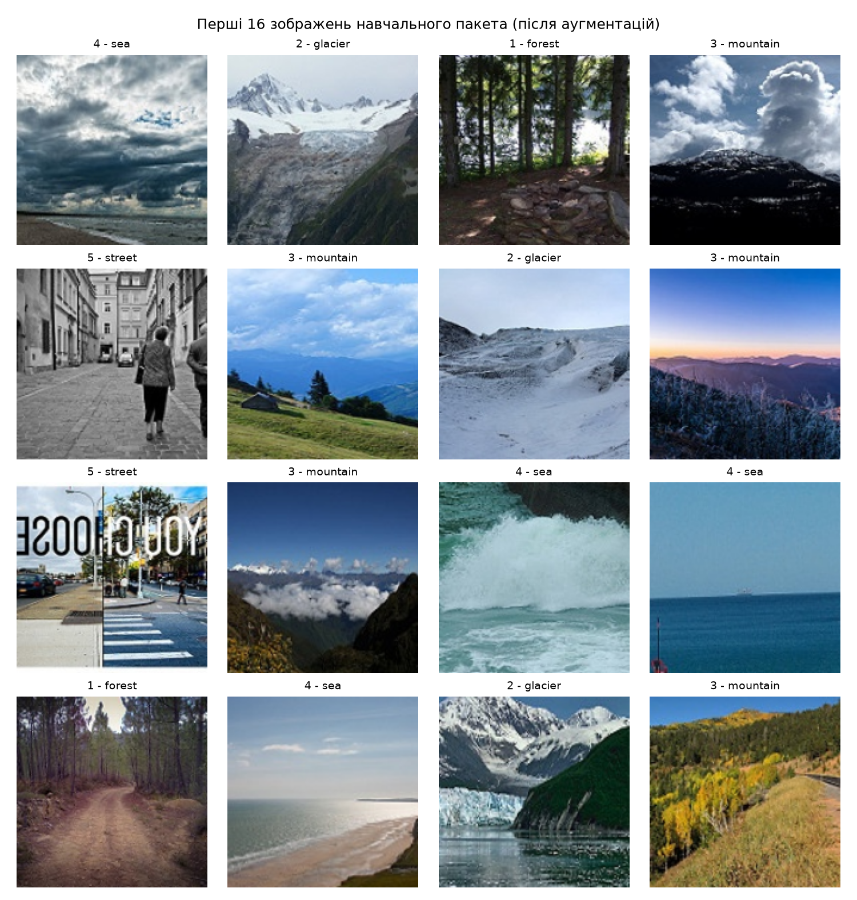
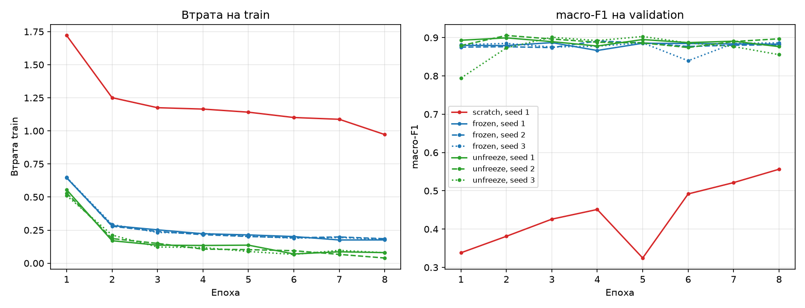
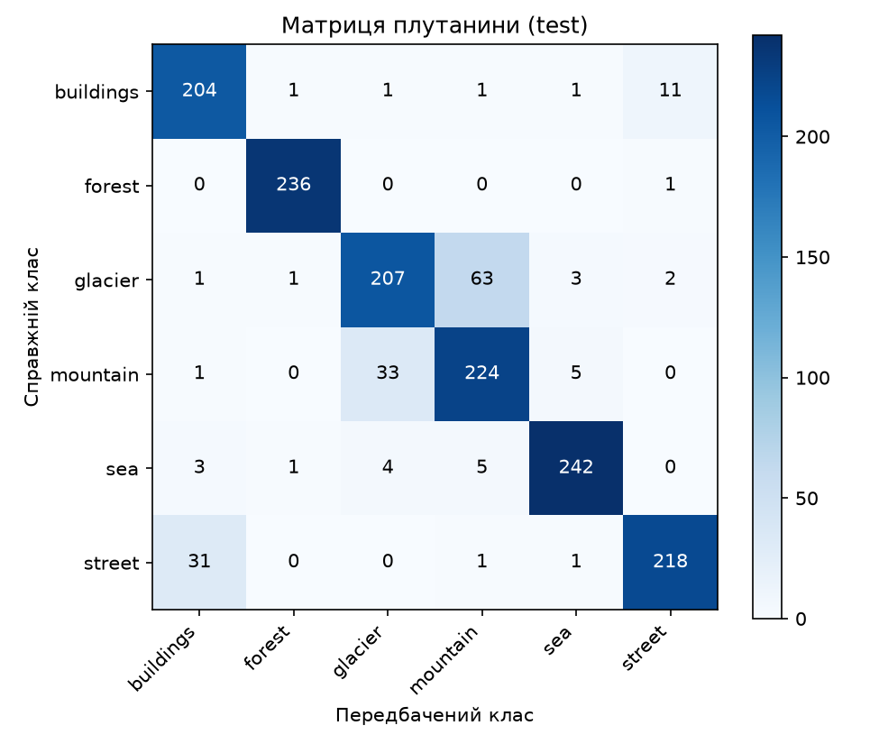
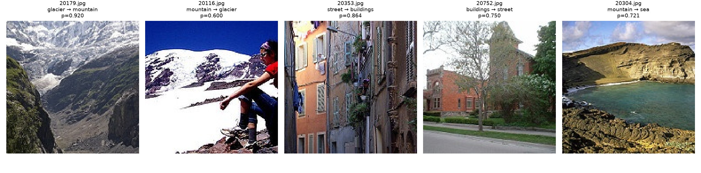

# ЛР3. Обчислювальний експеримент і трансферне навчання (ResNet-18)

Порівняння трьох режимів навчання ResNet-18 на малій вибірці (200 зображень на клас) за однакового бюджету 304 кроки оптимізатора: **scratch** (усе з випадкової ініціалізації), **frozen** (ImageNet-кістяк заморожено, навчається `fc`) і **unfreeze** (навчаються `layer4` і `fc`).

Набір: [Intel Image Classification (Kaggle)](https://www.kaggle.com/datasets/puneet6060/intel-image-classification), використано `seg_train/seg_train` і `seg_test/seg_test`; `seg_pred` не використовувався. Набір до репозиторію не додано. Вимагає облікового запису Kaggle.

## Запуск

Python 3.12, версії залежностей зафіксовано в `uv.lock` (torch 2.15.0, torchvision 0.29.2, numpy 2.5.5, pandas 3.1.1, scikit-learn 1.9.1, matplotlib 3.11.2, pillow 13.0.0). Шлях до локальної копії набору передається параметром `--data`: це тека, у якій лежать `seg_train` та `seg_test`.

```bash
uv run python train.py --data "<шлях до теки з seg_train і seg_test>"

uv run python analyze.py --data "<шлях до теки з seg_train і seg_test>"
```


| Файл | Призначення |
|---|---|
| `lab3_common.py` | поділ, датасет, перетворення, модель, режими, цикл навчання, журнали, правило вибору |
| `checks.py` | перевірки пунктів 1-2 |
| `train.py` | команда навчання |
| `analyze.py` | команда аналізу (єдине місце, де читається test) |
| `split.csv` | поділ (`file`, `label`, `part`) |
| `runs/<режим>_seed<зерно>/` | `run.json` і `val_logits.npy` кожного запуску (ваги `model.pt` лишаються локально) |
| `lab3_model.pt` | ваги вибраного запуску (`state_dict`, `regime`, `seed`, `classes`, `img_size`) |
| `selection.json`, `checks/`, `results/`, `figures/` | вибір, звіт перевірок, таблиці й рисунки |

Обліковий пристрій навчання: CPU (AMD64 Family 25 Model 80). Тест рахується на CPU.

## 1. Перевірки до навчання

### Поділ

Поділ побудовано за процедурою з завдання: окремий `np.random.default_rng(0)` для train (по черзі для всіх класів, `idx[:200]` після `shuffle`) і новий `np.random.default_rng(0)` для `seg_test` (`cut = n_k // 2`: `idx[:cut]` - validation, `idx[cut:]` - test). Клітинки: кількість / сума числових імен файлів. **Усі 18 клітинок і підсумки збігаються з контрольною таблицею.**

| Клас | train | validation | test |
|---|---:|---:|---:|
| buildings | 200 / 1 996 761 | 218 / 4 837 323 | 219 / 4 837 559 |
| forest | 200 / 2 032 625 | 237 / 5 276 962 | 237 / 5 291 326 |
| glacier | 200 / 2 183 923 | 276 / 6 135 652 | 277 / 6 157 250 |
| mountain | 200 / 1 950 345 | 262 / 5 789 535 | 263 / 5 849 765 |
| sea | 200 / 1 987 613 | 255 / 5 655 068 | 255 / 5 668 011 |
| street | 200 / 1 841 817 | 250 / 5 541 845 | 251 / 5 547 533 |
| **Разом** | **1200 / 11 993 084** | **1498 / 33 236 385** | **1502 / 33 351 444** |

Жоден файл не входить у дві частини (множини імен train, validation і test попарно не перетинаються, імена в `split.csv` унікальні). SHA-256 `split.csv`: `d3a611aec41f6e335ab58287f10a443f3e0e35aa9adfefae662d48b15af567f9`. Він записаний у всіх семи журналах і збігається з поточним файлом (це перевіряє `analyze.py`).

### Пакет після перетворень

Перші 16 зображень першого навчального пакета (після `RandomResizedCrop`, `RandomHorizontalFlip`, з оберненим нормуванням, мітка над кожним): `figures/train_batch.png`.



*Рис. 1. Перші 16 зображень першого навчального пакета (зерно 1) після `RandomResizedCrop(160, scale=(0.7, 1.0))`, `RandomHorizontalFlip()` та оберненого нормування (`x·std + mean`). Над кожним зображенням вказано індекс і назву класу. Зображення мають розмір 160×160, кольори природні, мітки відповідають вмісту, тож вхідний конвеєр даних працює правильно.*

### Початкова втрата

Модель за кроками 1-5 зі зерном 1, перший навчальний пакет, `set_train_mode` + `torch.no_grad()`, жодного кроку оптимізатора.

| Режим | L0 | ln 6 | L0 - ln 6 |
|---|---:|---:|---:|
| scratch | 2,1344 | 1,7918 | +0,3427 |
| frozen | 2,2155 | 1,7918 | +0,4238 |

L0 вище за ln 6 в обох режимах. Це очікувано: початкові логіти не нульові. Для довільних логітів $z$ середня за класами перехресна ентропія дорівнює $\mathrm{logsumexp}(z) - \overline{z} \ge \ln 6$ (рівність лише коли всі логіти однакові), тому рівномірні ймовірності - це нижня межа для збалансованих класів, а не типове значення випадкової ініціалізації. Один пакет з 32 зображень додає шум (класи в ньому не рівно збалансовані). У frozen відхилення більше, ймовірно, тому що ознаки передтренованого кістяка мають більшу амплітуду, ніж ознаки випадкової мережі, і випадковий `fc` дає більший розкид логітів. Розкид логітів я окремо не вимірював, тож це пояснення, а не виміряний факт.

## 2. Перевірка режимів навчання

### Параметри та групи оптимізатора

Усі числа збігаються з таблицею режимів. Жоден параметр із `requires_grad=False` в оптимізатор не потрапив (також множина параметрів оптимізатора дорівнює множині параметрів із `requires_grad=True`). Кількість параметрів - сума `numel()`.

| Режим | Усього | `requires_grad=True` | Групи (параметрів @ lr) |
|---|---:|---:|---|
| scratch | 11 179 590 | 11 179 590 | 11 179 590 @ 3·10⁻³ |
| frozen | 11 179 590 | 3 078 | 3 078 (`fc`) @ 3·10⁻³ |
| unfreeze | 11 179 590 | 8 396 806 | 3 078 (`fc`) @ 3·10⁻³; 8 393 728 (`layer4`) @ 3·10⁻⁴ |

### Що змінюється під час навчання (5 кроків, `set_train_mode`)

Порівняння точне (`torch.equal`) для повного `state_dict()` (параметри й буфери `running_mean`, `running_var`, `num_batches_tracked`). Усі рядки збіглися з очікуваним.

**frozen**

| Модуль | Параметри змінилися | Ковзні статистики BN змінилися | Збігається з очікуваним |
|---|:---:|:---:|:---:|
| conv1 | ні | немає BN | так |
| bn1 | ні | ні | так |
| layer1 | ні | ні | так |
| layer2 | ні | ні | так |
| layer3 | ні | ні | так |
| layer4 | ні | ні | так |
| fc | так | немає BN | так |

**unfreeze**

| Модуль | Параметри змінилися | Ковзні статистики BN змінилися | Збігається з очікуваним |
|---|:---:|:---:|:---:|
| conv1 | ні | немає BN | так |
| bn1 | ні | ні | так |
| layer1 | ні | ні | так |
| layer2 | ні | ні | так |
| layer3 | ні | ні | так |
| layer4 | так | так | так |
| fc | так | немає BN | так |

У scratch змінюється все, тому там перевіряти нічого.

### Дослід із навмисною помилкою (frozen + `model.train()`)

**Прогноз (записано до запуску).** Параметри замороженого кістяка не зміняться (`requires_grad=False`, градієнтів немає, в оптимізаторі їх немає), а ковзні статистики BN (`running_mean`, `running_var`, `num_batches_tracked`) у `bn1` та `layer1`-`layer4` зміняться, бо BN у режимі train оновлює їх під час прямого проходу. З кривої втрати на train це майже не буде помітно: втрата все одно падатиме, оскільки навчається голова, а зсув статистик лише дрібно змінює ознаки.

**Результат.**

| Модуль | Параметри змінилися | Ковзні статистики BN змінилися | Збігається з очікуваним (протоколом) |
|---|:---:|:---:|:---:|
| conv1 | ні | немає BN | так |
| bn1 | ні | **так** | ні |
| layer1 | ні | **так** | ні |
| layer2 | ні | **так** | ні |
| layer3 | ні | **так** | ні |
| layer4 | ні | **так** | ні |
| fc | так | немає BN | так |

Після 5 кроків у `layer1.0.bn1`: max |Δ`running_mean`| = **8,858·10⁻²**, max |Δ`running_var`| = **1,484·10⁻¹** (з `set_train_mode` обидві зміни дорівнюють нулю).

Прогноз у частині параметрів і статистик підтвердився. Частину прогнозу про криву втрати я **не перевіряв**: у досліді було лише 5 кроків, кривих втрати для варіанта з помилкою немає, тож «непомітно з кривої втрати» залишається припущенням.

**Чому `requires_grad=False` не захищає ці значення.** `running_mean` і `running_var` - не параметри, а буфери. Вони оновлюються не градієнтним спуском, а напряму під час прямого проходу BN у режимі `train()` за правилом `нове = (1 − momentum)·старе + momentum·статистика_батча` (momentum = 0,1). `requires_grad` стосується лише обчислення градієнтів, а режим `train()/eval()` визначає, чи BN рахує й накопичує статистику батча. Тому заморожений BN у режимі train дрейфує від статистик ImageNet до статистик малого набору, хоча ваги лишаються незмінними: ознаки зсуваються без жодного кроку оптимізатора.

**Чому для `layer4` у режимі unfreeze оновлення правильне.** Ваги `layer4` змінюються, тож розподіл його виходів теж змінюється. Статистики BN мають слідувати за ним, інакше в режимі `eval()` нормування не відповідатиме тому, на чому навчалась мережа. У режимах, де модуль заморожений, його вихідний розподіл не змінюється, і статистики мають лишатися статистиками ImageNet.

## 3. Сім запусків

| # | Режим | Зерно | Втрата train, епоха 8 | macro-F1 validation, епоха 8 | Час навчання, с |
|--:|---|--:|--:|--:|--:|
| 1 | scratch | 1 | 0,9722 | 0,5563 | 1005,0 |
| 2 | frozen | 1 | 0,1759 | 0,8829 | 485,3 |
| 3 | frozen | 2 | 0,1848 | 0,8814 | 474,0 |
| 4 | frozen | 3 | 0,1788 | 0,8864 | 492,1 |
| 5 | unfreeze | 1 | 0,0800 | 0,8765 | 562,4 |
| 6 | unfreeze | 2 | 0,0392 | 0,8970 | 565,5 |
| 7 | unfreeze | 3 | 0,0796 | 0,8555 | 566,3 |

Використано ваги після 8-ї епохи; епоху за validation не вибирали. Час навчання вимірено як повну тривалість 8 епох (wall-clock, CPU) **разом з обчисленням macro-F1 на validation після кожної епохи**; окремо тривалість лише навчальних фаз не зберігалась.



*Рис. 2. Втрата на train (ліворуч) і macro-F1 на validation (праворуч) за епохами для семи запусків на спільних осях. Час у таблиці вище включає обчислення macro-F1 на validation після кожної епохи.*

Орієнтири з завдання: frozen ≈ 0,88 (так і є, 0,8814-0,8864), scratch помітно менше й не близьке до 1/6 (0,5563), тобто ознак помилки BN чи нормування немає.

## 4. Розклад ефектів

$$\bar F_r = \frac13\sum_{s=1}^{3} F_{r,s},\qquad R_r = \max_s F_{r,s} - \min_s F_{r,s},\qquad R = \max(R_\text{frozen}, R_\text{unfreeze})$$

$$\Delta_\text{pre} = \bar F_\text{frozen} - F_{\text{scratch},1},\qquad \Delta_\text{unf} = \bar F_\text{unfreeze} - \bar F_\text{frozen}$$

| Величина | Значення |
|---|---:|
| $\bar F_\text{frozen}$ | 0,8836 |
| $R_\text{frozen}$ | 0,0051 |
| $\bar F_\text{unfreeze}$ | 0,8764 |
| $R_\text{unfreeze}$ | 0,0415 |
| $R$ | 0,0415 |
| $F_{\text{scratch},1}$ | 0,5563 |
| $\Delta_\text{pre}$ | **+0,3272** |
| $\Delta_\text{unf}$ | **−0,0072** |
| $\Delta_\text{pre}+\Delta_\text{unf}$ | +0,3200 (= $\bar F_\text{unfreeze} - F_{\text{scratch},1}$) |

Правило інтерпретації:
- **$\Delta_\text{pre}$ = +0,3272.** $|\Delta_\text{pre}| > R$ (≈ 7,9·$R$): ефект вартий перевірки, але формально не доведений (див. нижче).
- **$\Delta_\text{unf}$ = −0,0072.** $|\Delta_\text{unf}| \le R$ (≈ 0,17·$R$): різниця не відрізняється від розкиду, **результату немає**.

### Що змінює зерно в кожному режимі

- **scratch:** випадкову ініціалізацію всієї мережі (включно з `fc`), порядок пакетів і випадкові аугментації (обрізання, віддзеркалення).
- **frozen:** кістяк однаковий для всіх зерен (ваги ImageNet), тому зерно змінює лише ініціалізацію `fc`, порядок пакетів і аугментації.
- **unfreeze:** те саме, але ще й траєкторію навчання `layer4` (8,4 млн параметрів).

Розкид у frozen ($R_\text{frozen}$ = 0,0051) значно менший, ніж в unfreeze ($R_\text{unfreeze}$ = 0,0415). Імовірні причини: у frozen навчається лише лінійна голова на фіксованих ознаках (3 078 параметрів, задача опукла за вагами голови, тому початкова ініціалізація майже не впливає на результат), тоді як в unfreeze навчається великий блок із неопуклою задачею, який швидко переналаштовується на 1200 зображень (втрата train 0,04-0,08 проти ≈ 0,18 у frozen) і коливається за якістю між епохами (наприклад, seed 3: 0,9029 на епосі 5 і 0,8555 на епосі 8). Це пояснення, а не виміряний механізм; з трьох зерен розкид оцінюється дуже грубо.

### Чому $R$ з запусків 2-7 не характеризує розкид запуску 1 і чи змінює це висновок щодо $\Delta_\text{pre}$

$R$ виміряно лише на режимах із передтренованим кістяком. Scratch стартує з випадкової ініціалізації всієї мережі, тому його розкид між зернами може бути значно більшим, а для одного запуску він взагалі не виміряний. Крива запуску 1 це підтверджує: macro-F1 на validation стрибає 0,4513 → 0,3246 → 0,4919 на епохах 4-6 (коливання ≈ 0,13, що втричі більше за $R$), і до 8-ї епохи крива ще зростає (0,5563, втрата train 0,97), тобто scratch за 304 кроки не встиг збігтися.

Це не змінює напрямок висновку: різниця 0,33 більша і за $R$, і за видимі коливання кривої scratch. Але **за протоколом ефект не можна назвати доведеним**, поки немає кількох зерен для scratch: єдиний запуск не дає власної оцінки шуму.

### Чи однаковий бюджет за часом

Бюджет однаковий за кількістю кроків (304 кроки, 8 епох по 38), але не за часом:

| Режим | Середній час, с | Відносно frozen |
|---|--:|--:|
| frozen | 483,8 | 1,00 |
| unfreeze | 564,7 | 1,17 |
| scratch | 1005,0 | 2,08 |

Scratch потребує зворотного проходу через усю мережу й градієнтів усіх ваг, unfreeze - через `layer4`, frozen - лише через `fc`. Для scratch є одне вимірювання, і це був перший запуск у сесії; чи вплинули на нього «холодний» диск або кеші, я не перевіряв.

## 5. Вибір конфігурації і тестова оцінка

**Правило (лише за validation, у команді навчання).** Береться режим із найбільшим $\bar F_r$ (для scratch - його єдине значення), у ньому запуск із найбільшим $F_{r,s}$. Середні: scratch 0,5563, frozen 0,8836, unfreeze 0,8764. Вибрано **frozen, seed 3** ($F$ = 0,8864); його ваги збережено як `lab3_model.pt`. `analyze.py` перевірив, що `lab3_model.pt` відповідає цьому правилу за журналами.

Оскільки $|\Delta_\text{unf}| \le R$, **вибір між frozen і unfreeze визначив шум**: середні відрізняються на 0,0072 при розкиді 0,0415. Процедура від цього не змінюється.

### Test (один раз, CPU, `lab3_model.pt`)

| Метрика | Значення |
|---|---:|
| macro-F1 (test) | **0,8892** |
| macro-F1 (validation, той самий запуск) | 0,8864 |
| accuracy (test) | 0,8862 |
| SE = √(p(1−p)/n), n = 1502 | 0,0082 |

**Матриця плутанини** (рядки - справжній клас, стовпці - передбачений):

| | buildings | forest | glacier | mountain | sea | street |
|---|--:|--:|--:|--:|--:|--:|
| **buildings** | 204 | 1 | 1 | 1 | 1 | 11 |
| **forest** | 0 | 236 | 0 | 0 | 0 | 1 |
| **glacier** | 1 | 1 | 207 | 63 | 3 | 2 |
| **mountain** | 1 | 0 | 33 | 224 | 5 | 0 |
| **sea** | 3 | 1 | 4 | 5 | 242 | 0 |
| **street** | 31 | 0 | 0 | 1 | 1 | 218 |



### Зміщення вибору «кращого з трьох»

Вибір найкращого запуску робить валідаційне число оптимістичним. Усередині validation це видно: вибраний запуск (0,8864) вищий за середнє frozen (0,8836) на 0,0028. Між validation і test зміщення **не видно**: macro-F1 на test навіть вища (0,8892; різниця val − test = −0,0028, тобто протилежного знаку). Причини:

- Очікуваний порядок зміщення мізерний. Розкид frozen $R_\text{frozen}$ = 0,0051, тож «кращий з трьох» перевищує середнє лише на соту частки (для трьох нормальних значень $E[\max-\text{mean}]\approx 0{,}85\sigma$, при $\sigma\approx R/1{,}69\approx 0{,}003$ це ≈ 0,0025).
- Шум скінченної вибірки значно більший: SE частки правильних відповідей на test ≈ 0,0082 (це оцінка для accuracy, для macro-F1 лише порядок величини). Різниця −0,0028 втричі менша за SE, тож її знак визначається шумом, а не зміщенням.
- Validation і test - це різні половини `seg_test` (1498 і 1502 зображення), і в кожної свої «легкі» та «важкі» приклади.

### П'ять характерних помилок

Перші п'ять позадіагональних пар за частотою (за рівної частоти - за зростанням індексу справжнього, потім передбаченого класу), для кожної перший за іменем (як рядок) файл test із такою помилкою.

| Файл | Справжній клас | Передбачений клас | Імовірність передбаченого класу | Кількість таких помилок у test |
|---|---|---|--:|--:|
| 20179.jpg | glacier | mountain | 0,9199 | 63 |
| 20116.jpg | mountain | glacier | 0,5996 | 33 |
| 20353.jpg | street | buildings | 0,8640 | 31 |
| 20752.jpg | buildings | street | 0,7497 | 11 |
| 20304.jpg | mountain | sea | 0,7211 | 5 |



Пара (mountain → sea) ділить частоту 5 із парою (sea → mountain); за правилом першою береться пара з меншим індексом справжнього класу.

**Категорії помилок** *(заповніть самі після перегляду `figures/five_errors.png`; нижче лише відправні гіпотези за парою класів, їх треба підтвердити на кожному зображенні)*:

1. `20179.jpg` (glacier → mountain, p = 0,92): *[категорія й одне речення]*. Плутанина glacier ↔ mountain - властивість набору (засніжені гори й льодовики візуально перетинаються), а не вада, яку треба виправляти: на неї припадає 96 із 193 помилок test (63 + 33).
2. `20116.jpg` (mountain → glacier, p = 0,60): *[категорія й одне речення]*.
3. `20353.jpg` (street → buildings, p = 0,86): *[категорія й одне речення]*. Гіпотеза: вулична сцена містить будівлі.
4. `20752.jpg` (buildings → street, p = 0,75): *[категорія й одне речення]*.
5. `20304.jpg` (mountain → sea, p = 0,72): *[категорія й одне речення]*.

За рівнем класів найгірший recall у glacier (207/277 ≈ 0,75: 63 зображення, тобто 22,7 %, прийняті за mountain); найкращий у forest (236/237 ≈ 0,996).

## 6. Висновок

Усі числа нижче взято з таблиць пунктів 3-5. Обидва ефекти виміряно за конкретного бюджету в **304 кроки**; з довшим навчанням scratch міг би скоротити відставання (його крива до 8-ї епохи ще росла, а втрата train лишалася 0,97).

**Попереднє навчання ($\Delta_\text{pre}$).** Напрям: на користь передтренованих ознак. Величина: +0,3272 пункту macro-F1 (frozen 0,8836 проти scratch 0,5563). Співвідношення з розкидом: $\Delta_\text{pre}$ ≈ 7,9·$R$ ($R$ = 0,0415), тобто правило дає «ефект вартий перевірки, але не доведений». Це формальний вердикт, бо scratch має лише один запуск і його власний розкид невідомий; але різниця більша й за $R$, й за коливання кривої scratch між епохами (≈ 0,13), тож напрям ефекту сумнівів не викликає.

**Донавчання кістяка ($\Delta_\text{unf}$).** Напрям: слабко негативний (unfreeze 0,8764 нижче за frozen 0,8836). Величина: −0,0072 пункту. Співвідношення з розкидом: $|\Delta_\text{unf}|$ ≈ 0,17·$R$, тобто **різниця не відрізняється від розкиду, результату немає**. Діапазони перекриваються: seed 2 unfreeze (0,8970) вищий за всі frozen, а seed 3 (0,8555) нижчий за всі. Донавчання `layer4` суттєво знижує втрату на train (0,04-0,08 проти ≈ 0,18), але на validation це не перетворюється на виграш; на цьому бюджеті воно переналаштовується на 1200 зображень.

**Для нової задачі з 200 зображеннями на клас** я взяв би режим **frozen**: якість така сама, як в unfreeze (різниця менша за розкид), розкид у вісім разів менший ($R_\text{frozen}$ = 0,0051 проти 0,0415, тобто результат стабільніший між запусками), навчання на 17 % швидше (484 с проти 565 с), а scratch на цьому бюджеті надто слабкий і вдвічі повільніший (1005 с).

## Відхилення від фіксованих налаштувань і примітки

- Відхилень від фіксованих налаштувань немає; версії бібліотек вказано вище.
- Хеш коміту й ознака незакомічених змін записані в кожному `run.json`. *[Вкажіть, чи збігаються коміти семи запусків; якщо різні, поясніть чому. Значення `unknown` означає, що тека не була git-репозиторієм на момент запуску.]*
- Нічия у правилі вибору (не визначена в завданні) розв'язується меншим індексом режиму/зерна; у нашому прогоні нічиїх не було.
- Валідаційні логіти після 8-ї епохи збережено в `runs/*/val_logits.npy`; `analyze.py` відтворює з них macro-F1 і порівнює з журналом.

## Джерела та використання генеративних інструментів

- Набір: Intel Image Classification (Kaggle); ваги `ResNet18_Weights.IMAGENET1K_V1` з torchvision.
- Код `lab3_common.py`, `checks.py`, `train.py`, `analyze.py` і чернетка цього README створені за допомогою генеративного інструмента Claude (Anthropic); автор перевірив і розуміє код та результати. *(Змініть цей пункт відповідно до того, що ви реально використовували.)*
